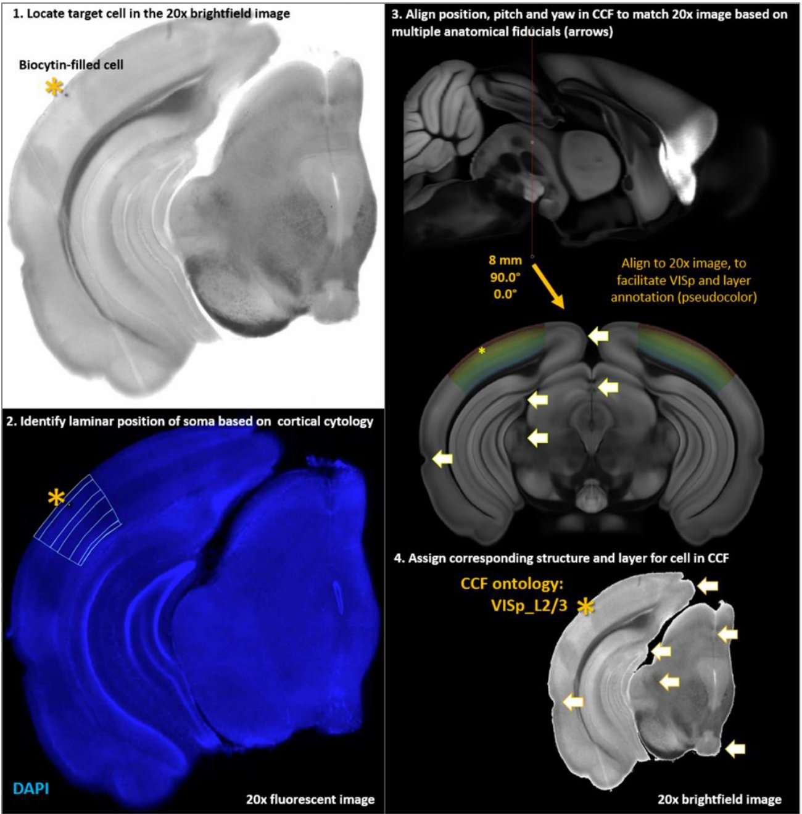
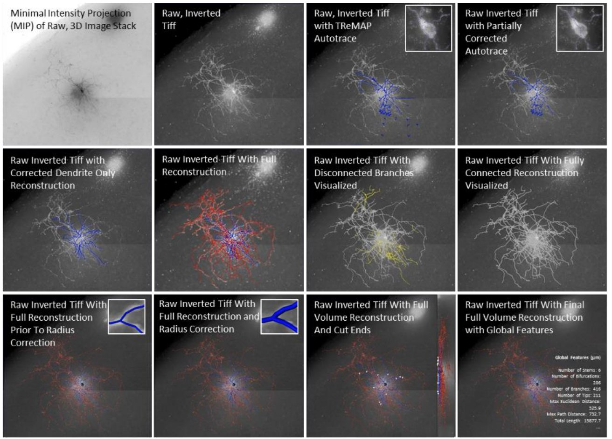
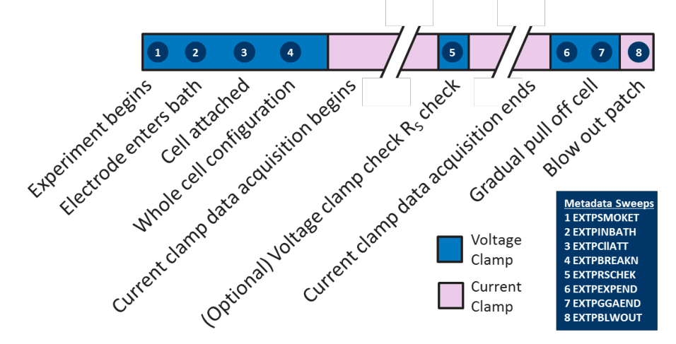
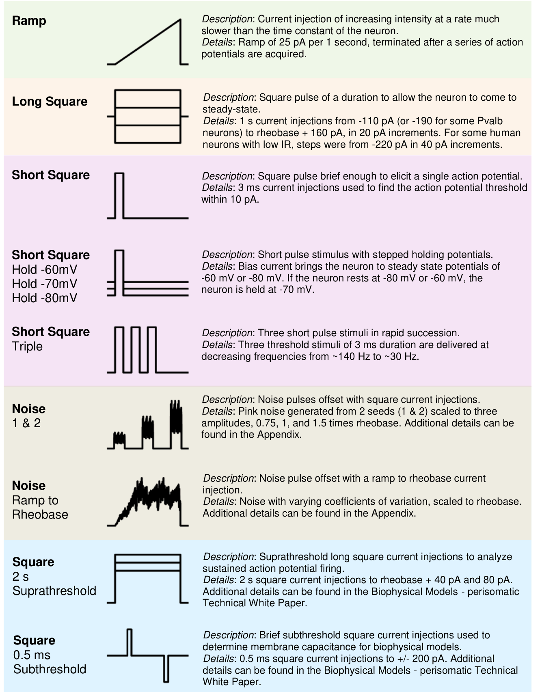
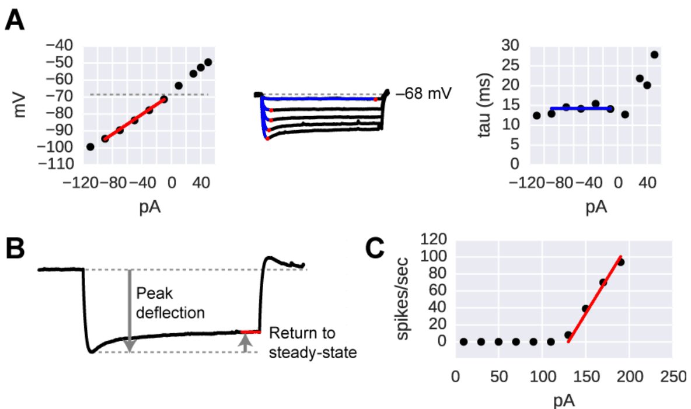
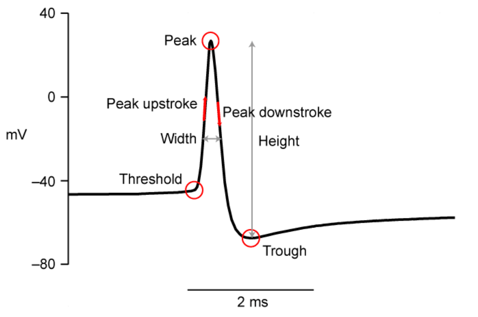
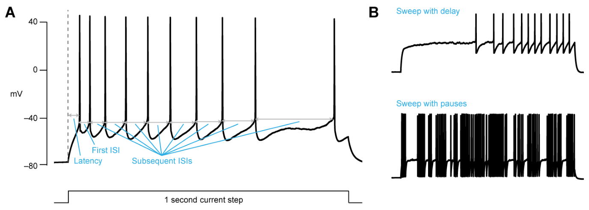
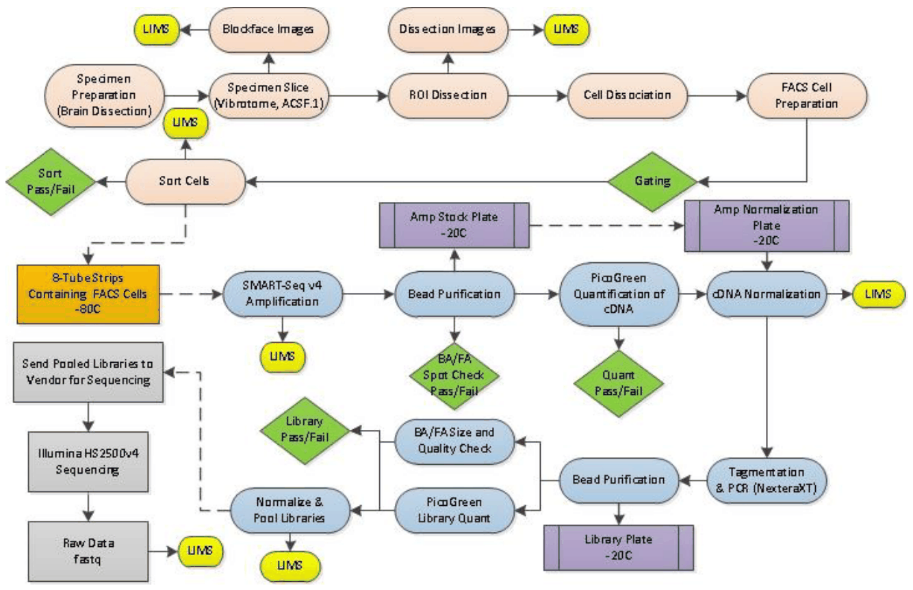

# Glossary

What the columns and concepts of the course data mean: the cells table, anatomy, electrophysiology and
transcriptomics. All tables are made by `00_Build_Course_Data.ipynb` and saved in `data/`; every row is one cell, and
every table joins to `cells.csv` on `cell_id`. The source of each column is listed in `data/DATA_DICTIONARY.md`.

**Contents:** [Papers and white papers](#papers-and-white-papers) ·
[How to read the column names](#how-to-read-the-column-names) · [The cells table](#the-cells-table) ·
[Anatomy](#anatomy) · [Electrophysiology](#electrophysiology) · [Transcriptomics](#transcriptomics)

## Papers and white papers

**The two datasets**

| | paper | what it is |
|---|---|---|
| mouse | Gouwens, Sorensen et al. (2020) *Cell* 183:935. [doi:10.1016/j.cell.2020.09.057](https://doi.org/10.1016/j.cell.2020.09.057) | ~4,400 GABAergic interneurons of mouse visual cortex; defines the MET-types |
| human | Lee, Dalley et al. (2023) *Science* 382:eadf6484. [doi:10.1126/science.adf6484](https://doi.org/10.1126/science.adf6484) | ~780 GABAergic interneurons from human neurosurgical tissue, many recorded in slice culture |

**Methods: the Allen Institute's technical white papers** (they describe the Allen Cell Types pipeline that the
Patch-seq experiments are built on)

| white paper | useful for |
|---|---|
| [Electrophysiology](https://s3.amazonaws.com/webflow-prod-assets/689cfbd308fa7373b604d290/68ee796e6df1cc984c3ab432_Documentation_Cell_Types_Database-Electrophysiology_Overview.pdf) (v.5, Oct 2017) | stimuli, recording, quality control, definitions of all ephys features |
| [Cell Morphology and Histology](https://s3.amazonaws.com/webflow-prod-assets/689cfbd308fa7373b604d290/68ee796d43e1a8e8d93842f3_Documentation_Cell_Types_Database-Morphology_and_Histology_Overview.pdf) (v.7, June 2018) | biocytin staining, reconstruction, spiny / aspiny, definitions of the morphology features (Table 6) |
| [Transcriptomics](https://s3.amazonaws.com/webflow-prod-assets/689cfbd308fa7373b604d290/68e7f045b6ee524918d5fbd2_CellTypes_Transcriptomics_Overview.pdf) (v.4, Oct 2018) | SMART-Seq v4, read counting, quality control, clustering into a taxonomy (for dissociated cells, not Patch-seq) |
| [Overview](https://s3.amazonaws.com/webflow-prod-assets/689cfbd308fa7373b604d290/68ee796d3e95893f72103c64_Documentation_Cell_Types_Database-Overview.pdf) · [Mouse CCF v3](https://s3.amazonaws.com/webflow-prod-assets/689cfbd308fa7373b604d290/68ee796f92b89d46f3ecaf67_Documentation_Cell_Types_Database-Mouse_CCF%2C_Reference_Atlas%2C_Version_3_(2017).pdf) | the whole pipeline; the mouse brain atlas |

All of them are listed on the Allen Institute's
[Cell Types documentation page](https://brain-map.org/support/documentation/documentation-cell-types-database).
The figures in this glossary are taken from these white papers (© Allen Institute for Brain Science, reused for
teaching with attribution; see the [Allen Institute terms of use](https://alleninstitute.org/terms-of-use/)).

**More papers**

| paper | why it matters for the course |
|---|---|
| Lee et al. (2021) *eLife* 10:e65482. [doi:10.7554/eLife.65482](https://elifesciences.org/articles/65482) | the Patch-seq method itself ("the Patch-seq white paper"); step-by-step [protocol](https://www.protocols.io/view/patch-seq-recording-and-extraction-detailed-protoc-5qpvoyb2bg4o/v) |
| Gouwens et al. (2019) *Nat Neurosci* 22:1182. [doi:10.1038/s41593-019-0417-0](https://doi.org/10.1038/s41593-019-0417-0) | the most complete definitions of the ephys and morphology features ([supplementary information, from p. 73](http://static-content.springer.com/esm/art%3A10.1038%2Fs41593-019-0417-0/MediaObjects/41593_2019_417_MOESM1_ESM.pdf#page=73)) |
| Tasic et al. (2018) *Nature* 563:72. [doi:10.1038/s41586-018-0654-5](https://doi.org/10.1038/s41586-018-0654-5) | the mouse cortical cell type taxonomy (the t-types of the mouse cells) |
| Hodge et al. (2019) *Nature* 573:61. [doi:10.1038/s41586-019-1506-7](https://doi.org/10.1038/s41586-019-1506-7) | human cortical cell types, and their mouse counterparts |
| Gala et al. (2021) *Nat Comput Sci* 1:120. [doi:10.1038/s43588-021-00030-1](https://doi.org/10.1038/s43588-021-00030-1) | source of the mouse input resistance and the `ap1_...` features ([code and data](https://github.com/AllenInstitute/coupledAE-patchseq)) |
| Winnubst et al. (2019) *Cell* 179:268. [doi:10.1016/j.cell.2019.07.042](https://doi.org/10.1016/j.cell.2019.07.042) | MouseLight: complete, whole-brain reconstructions of projection neurons |
| Wang et al. (2020) *Cell* 181:936. [doi:10.1016/j.cell.2020.04.007](https://doi.org/10.1016/j.cell.2020.04.007) | the Allen Mouse Brain Common Coordinate Framework (CCF v3) |

**Software:** [IPFX](https://github.com/AllenInstitute/ipfx) (Allen ephys feature extraction) ·
[pynwb](https://pynwb.readthedocs.io) (reading NWB files) · [DANDI](https://dandiarchive.org) (raw recordings) ·
[AnnData](https://anndata.readthedocs.io) (expression files) · [BrainGlobe](https://brainglobe.info) (brain atlases)

## How to read the column names

* **Mouse columns end with their unit:** `_mv` millivolt, `_pa` picoampere, `_mohm` megaohm, `_ms` millisecond,
  `_s` second, `_hz` hertz, `_mv_per_ms` millivolt per millisecond, `_mm` millimeter, `_um` micrometer. No suffix: a
  count, a ratio, or a unit given in the tables below.
* **Human columns** use the original names of the human dataset, **without units in the name**: lengths in µm, areas in
  µm², voltages in mV, currents in pA, resistance in MΩ, but **times in seconds**.
* So, before comparing mouse and human, convert: human µm ÷ 1000 → mm, human s × 1000 → ms.

## The cells table

`cells.csv`: one row per neuron, both species.

| column | meaning |
|---|---|
| `cell_id` | course-wide id, `mouse_<specimen_id>` or `human_<specimen_id>`; the key that joins all tables |
| `species`, `dataset` | `mouse` (`Gouwens2020`) or `human` (`LeeDalley2023`) |
| `specimen_id`, `cell_name` | the Allen Institute's id and name of the cell (the ones used on brain-map.org) |
| `donor_id`, `sex`, `age_days` | the mouse or patient the cell came from, its sex and age in days |
| `genotype` | (mouse) the transgenic line: a **Cre line** (e.g. `Sst-IRES-Cre`) crossed with a reporter (`Ai14`) makes one cell type fluorescent, so it can be targeted for patching |
| `hemisphere`, `area`, `lobe`, `structure` | where the cell was: cortical area (mouse: VISp and other visual areas; human: MTG, SFG, ...), human lobe; `structure` = area + layer |
| `layer` | cortical layer of the cell body (L1 at the surface, L6 at the bottom) |
| `soma_depth_normalized` | (mouse) depth of the cell body: 0 at the pia (surface), 1 at the white matter |
| `depth_from_pia_um`, `depth_source` | (human) depth of the cell body from the pia, in µm; from the reconstruction or the slice image |
| `cell_depth_from_slice_surface` | (human) how deep below the surface of the *slice* the cell was patched, in µm (not the depth in the cortex) |
| `dendrite_type` | (mouse) spiny, aspiny or sparsely spiny (see [Anatomy](#anatomy)) |
| `reconstruction_type` | (mouse) `full` (axon and dendrites) or `dendrite-only` |
| `preparation`, `days_in_culture`, `virus` | (human) `acute`: recorded on the day of surgery; `culture`: the slice was kept alive for days first, often infected with a virus that labels a cell type |
| `disease` | (human) why the patient had surgery (epilepsy, tumor, ...): the tissue is from outside the diseased region |
| `class` > `subclass` > `t_type` | cell type labels from the transcriptome, from broad to fine (see [Transcriptomics](#transcriptomics)). Mouse `class`: MGE / CGE (the embryonic origin of the interneuron); human: GABAergic neuron |
| `t_type_probability` | how confidently the cell was mapped to its t-type (0 to 1) |
| `subclass_harmonized` | a coarse common subclass for mouse and human (Pvalb, Sst, Vip, Lamp5/Pax6/Other), made by the course; an approximation, not a published homology |
| `met_type` | (mouse) morpho-electric-transcriptomic type: a type defined by all three modalities together (Gouwens et al. 2020) |
| `cross_species_type` | (human) the mouse–human homologous type, where known (Hodge et al. 2019) |
| `morphology_type_qualitative` | (human) shape named by an expert: basket cell, Martinotti cell (MC), double bouquet cell (DBC), ... |
| `transcriptomic_sample_id`, `ephys_session_id` | ids of the RNA sample and of the recording |
| `in_published_analysis` | whether the paper used this cell (some cells failed quality control) |
| `has_morphology`, `has_ephys`, `has_transcriptome` | which data exist for this cell (True / False) |
| `swc_url`, `nwb_url`, `dandiset` | download links of the reconstruction (SWC) and the recording (NWB), and the DANDI archive dataset |

## Anatomy

### Concepts

| term | meaning |
|---|---|
| **biocytin fill** | during the recording, the dye biocytin diffuses from the pipette into the cell; after staining, the whole cell becomes visible |
| **reconstruction** | a 3D tracing of the cell, made from microscope images (semi-automatically, then corrected by hand) |
| **SWC file** | the text file of a reconstruction: one line per point, with `id`, `type`, `x`, `y`, `z`, `radius`, `parent` |
| **node type** (`type`) | 1 = soma, 2 = axon, 3 = (basal) dendrite, 4 = apical dendrite. Interneurons have no apical dendrite |
| **parent** | the point a point is connected to; `-1` marks the root (the soma) |
| **transformed / upright / layer-aligned** | versions of a reconstruction rotated so that the y axis is perpendicular to the cortical surface (pia up); *layer-aligned* files are also stretched to a standard layer thickness |
| **dendrite type** | spiny (excitatory cells), aspiny or sparsely spiny (interneurons), judged from the density of dendritic spines |
| **CCF** | the Allen Mouse Brain Common Coordinate Framework: a standard 3D map of the mouse brain in µm, used to place cells from different brains together |
| **MouseLight** | a Janelia project that reconstructs complete projection neurons across the whole mouse brain, placed in the CCF |

*How a cell gets its area and layer (`area`, `layer`, `structure` in `cells.csv`): the biocytin-filled cell is found in the slice (1), its layer is read from the DAPI-stained cytoarchitecture (2), the slice is matched to the same plane of the CCF atlas (3), and the cell gets the CCF structure at that point, here VISp layer 2/3 (4). Figure 2 of the Cell Morphology and Histology white paper (Allen Institute, 2018).*

*How an SWC file is made: an automatic trace of the 3D image stack (blue) is corrected by hand in Vaa3D, the axon is added (red), loose pieces are connected, the radii are corrected and cut ends are marked; the global features are computed from the finished reconstruction. Figure 3 of the Cell Morphology and Histology white paper (Allen Institute, 2018).*

### Morphology features

`data/mouse_morph_features.csv` (lengths in mm) and `data/human_morph_features.csv` (lengths in µm, same names
without the `_mm`). In interneurons all dendrites are "basal dendrites". Each feature exists for the axon
(`axon_...`) and the dendrites (`basal_dendrite_...`). x is the direction along the cortical surface, y the depth
(perpendicular to the surface).

| column (mouse) | what it measures | related concepts |
|---|---|---|
| `..._total_length_mm` | total length of all branches | size of the cell, input resistance (cable theory) |
| `..._num_branches` | number of branches (pieces between two branch points or tips) | complexity |
| `..._max_branch_order` | the most branch points on the way from the soma to any tip | how deeply the tree branches |
| `basal_dendrite_num_stems` (human: `..._calculate_number_of_stems`) | number of dendrites leaving the soma | multipolar vs bipolar cells |
| `basal_dendrite_stem_exit_up`, `_down`, `_side_less`, `_side_more` (human: `_side`) | fraction of the dendrite stems leaving the soma upwards, downwards or sideways | bipolar (Vip) vs multipolar shapes |
| `..._extent_x_mm`, `..._extent_y_mm` | width and height of the arbor | horizontal vs vertical cells |
| `..._max_euclidean_distance_mm` | straight-line distance from the soma to the farthest point | reach |
| `..._max_path_distance_mm` | distance along the branches from the soma to the farthest point | signal travel distance |
| `..._contraction` (human: `..._mean_contraction`) | straight-line length ÷ path length of the branches; 1 = perfectly straight | tortuosity |
| `..._bias_x_mm`, `..._bias_y_mm` | how lopsided the arbor is around the soma, sideways (x) or up–down (y) | e.g. an axon climbing to layer 1 (Martinotti cells) |
| `..._soma_percentile_x`, `..._soma_percentile_y` | where the soma lies within the arbor (0 to 1; 0.5 = in the middle) | |
| `axon_soma_distance_mm` (human: `axon_exit_distance`), `axon_soma_theta` (human: `axon_exit_theta`) | where the axon leaves the cell: distance from the soma, and angle | |
| `axon_pct_above_basal_dendrite`, `..._below_...`, `..._intersect_...` (human: `frac_` instead of `pct_`) | fraction of the axon above, below, or at the same depths as the dendrites (and the same for the dendrites vs the axon) | which layers the cell gets input from vs sends output to |
| `axon_emd_with_basal_dendrite` | how different the depth profiles of the axon and the dendrites are (earth mover's distance) | input vs output layers |
| `axon_hist_pc_0` … `_4` (human: `axon_depth_pc_0` … `_3`) | a compact summary of the axon's depth profile (principal components of the histogram of axon length per depth) | the layers the axon targets |

Human only: `soma_surface` (µm²), `soma_aligned_dist_from_pia` (soma depth in the layer-aligned reconstruction, µm),
`basal_dendrite_mean_diameter` (µm), `basal_dendrite_total_surface_area` (µm²), and ratios such as
`axon_over_basal_dendrite_extent_x` (axon width ÷ dendrite width) and `axon_extent_x_over_y` (width ÷ height).

Definitions: Morphology and Histology white paper (Table 6) and Gouwens et al. (2019), supplementary information.

## Electrophysiology

### Concepts

| term | meaning |
|---|---|
| **current clamp** | the amplifier injects a known current and records the membrane voltage |
| **sweep** | one run of a stimulus; a recording is a series of sweeps |
| **NWB** | Neurodata Without Borders, the file format of the recordings (`nwb.acquisition`: voltages, `nwb.stimulus`: currents) |
| **test pulse** | a short pulse at the start of each sweep (within the first 0.1 s), used to check the recording quality |
| **test sweeps** (`EXTP...`) | voltage-clamp sweeps recorded before and after the experiment to check the seal and the electrode (see Figure 2 below); not used for the features |

The stimuli, and how they appear in the column names:

| part of the name | protocol | what it is |
|---|---|---|
| `long_square` | long square | a 1 s step of constant current (the protocol of `02_Electrophysiology.ipynb`) |
| `short_square` | short square | a 3 ms pulse of current, just strong enough to fire one spike |
| `ramp` | ramp | a current that slowly increases until the cell fires |
| `rheobase` / `rheo` | long square at rheobase | the smallest long square that made the cell fire |
| `hero` | "hero" sweep | a long square somewhat above the rheobase, firing a regular train of spikes |
| `chirp` (human) | chirp | a small sine-wave current whose frequency rises over time |

Protocol names in the NWB files: cells recorded before 2018 use codes like `C1LSCOARSE...` (long square),
`C1SSFINEST...` (short square) and `C1RP...` (ramp); later cells use `X1PS_SubThresh`, `X3LP_Rheo`,
`X4PS_SupraThresh` (long squares), `X6SP_Rheo` (short square) and `X7Ramp`. `EXTP...` sweeps are quality checks.

*The order of an experiment. The numbered `EXTP...` test sweeps (voltage clamp, blue) check the electrode and the seal before and after the current-clamp recordings (pink) that the features come from. Figure 2 of the Electrophysiology white paper (Allen Institute, 2017).*

*The stimuli. Not every cell got every one; the course uses the long squares, short squares and ramps. Figure 3 of the Electrophysiology white paper (Allen Institute, 2017).*

### 1. Passive properties (no spikes involved)

| column (mouse) | what it measures | unit | related concepts |
|---|---|---|---|
| `vrest_mv` | Resting membrane potential: the voltage when no current is injected | mV | ion gradients, leak channels, Nernst / Goldman equation |
| `input_resistance_mohm` | Input resistance: how much the voltage changes per injected current, from the hyperpolarizing long squares (slope of the largest voltage change against the current) | MΩ | Ohm's law, cell size, number of open channels |
| `tau` | Membrane time constant: how fast the voltage approaches its new level after a small hyperpolarizing step (exponential fit) | ms | membrane capacitance, resistance × capacitance, temporal summation |
| `sag` | How much the voltage creeps back during a hyperpolarizing step: (largest deflection − steady state) / (largest deflection − baseline). 0 = no sag | ratio | HCN channels, *I*h |
| `sag_nearest_minus_100` | The same sag ratio, on the sweep closest to −100 pA | ratio | *I*h |
| `sag_measured_at_mv` | The voltage at the largest deflection of that sweep (how hyperpolarized the cell was when sag was measured) | mV | voltage dependence of *I*h |

*Features from several sweeps. A: the lowest voltage of each hyperpolarizing step (red dots) against the current; the slope of the line is the input resistance (left). Exponential fits (blue) give the time constant of each step, averaged into `tau` (right). B: sag = return to steady state ÷ peak deflection. C: the f–I curve; the slope of the line above rheobase is `f_i_curve_slope`. Figure 6 of the Electrophysiology white paper (Allen Institute, 2017).*

### 2. When does the cell fire?

| column (mouse) | what it measures | unit | related concepts |
|---|---|---|---|
| `threshold_i_long_square_pa` | **Rheobase**: the smallest long-square current that made the cell fire | pA | excitability, input resistance |
| `threshold_i_short_square_pa` | The smallest 3 ms pulse that made the cell fire | pA | excitability, membrane charging |
| `short_square_current_pa` | The current of the short-square sweep used for the `ap1_..._short_square` features | pA | |
| `threshold_i_ramp_pa` | The current at which the ramp evoked the first spike | pA | excitability |
| `threshold_v_long_square_mv`, `..._short_square_mv`, `..._ramp_mv` | **Spike threshold**: the voltage where the first spike takes off (where the rate of rise passes a set fraction of its maximum) | mV | sodium channel activation |
| `latency` | Time from the start of the step to the threshold of the first spike, on the hero sweep | s | integration, A-type potassium currents (delayed firing) |
| `latency_rheobase_s` | The same, on the rheobase sweep (so it is usually longer) | s | |

### 3. Shape of the action potential

These describe the **first spike** (`ap1_` = first action potential): for `long_square`, the first spike of the
rheobase sweep; for `short_square` and `ramp`, the first spikes of several sweeps, averaged.

*Features of a single action potential, evoked by a long square. Figure 4 of the Electrophysiology white paper (Allen Institute, 2017).*

| column (mouse) | what it measures | unit | related concepts |
|---|---|---|---|
| `peak_v_..._mv`, `ap1_peak_v_..._mv` | Peak: the highest voltage of the spike | mV | sodium channels, driving force |
| `fast_trough_v_..._mv`, `ap1_fast_trough_v_..._mv` | Fast trough: the lowest voltage within 5 ms after the peak | mV | fast afterhyperpolarization, Kv3 and BK channels |
| `trough_v_..._mv` | Trough: the lowest voltage between this spike and the next one (or the end of the step) | mV | slower afterhyperpolarization |
| `ap1_upstroke_..._mv_per_ms` | Upstroke: the fastest rate of rise of the spike | mV/ms | sodium channel density |
| `ap1_downstroke_..._mv_per_ms` | Downstroke: the fastest rate of fall (negative) | mV/ms | potassium channels (repolarization) |
| `upstroke_downstroke_ratio_...`, `ap1_upstroke_downstroke_ratio_...` | Upstroke / &#124;downstroke&#124;. Fast-spiking (Pvalb) cells repolarize very fast, so their ratio is low | ratio | Kv3 channels, fast-spiking cells |
| `ap1_width_long_square_ms`, `ap1_width_short_square_ms` | Spike width at half height: the duration of the spike halfway between its peak and the trough after it | ms | how fast the spike repolarizes; narrow spikes in Pvalb cells |

### 4. Spike trains

| column (mouse) | what it measures | unit | related concepts |
|---|---|---|---|
| `f_i_curve_slope` | Slope of the f–I curve above rheobase: how much the firing rate grows per extra pA | Hz/pA | gain, input–output function |
| `avg_isi` | Average interspike interval (time between spikes) on the hero sweep | ms | firing rate = 1000 / ISI |
| `adaptation` | Adaptation index: how much the spikes slow down (positive) or speed up (negative) during the hero sweep; average of (ISIn+1 − ISIn) / (ISIn+1 + ISIn). 0 = perfectly regular | ratio | spike-frequency adaptation, Ca²⁺-activated K⁺ channels, M-current |
| `avg_rate_rheobase_hz` | Firing rate on the rheobase sweep | Hz | |

*Spike train features. A: latency (from the start of the step to the first spike) and the interspike intervals (ISIs), from which `avg_isi` and `adaptation` are computed. B: a cell that starts firing late (delay, typical of some Lamp5 / neurogliaform cells) and a cell that stops and restarts (pauses). Figure 5 of the Electrophysiology white paper (Allen Institute, 2017).*

### 5. Human features

The human table uses the IPFX names directly. **The unit is not in the name**: voltages are in mV, currents in pA,
resistance in MΩ, but **times are in seconds** (`tau`, `width_...`, `latency_...`, `..._isi_...`). Multiply by 1000
to compare them with the mouse `_ms` columns.

| mouse column | human column | note |
|---|---|---|
| `vrest_mv` | `v_baseline` | |
| `input_resistance_mohm` | `input_resistance` | both MΩ |
| `tau` (ms) | `tau` (s) | human × 1000 |
| `threshold_i_long_square_pa` | `rheobase_i` | |
| `f_i_curve_slope` | `fi_fit_slope` | |
| `sag` | `sag` | human: measured near −90 mV (`vm_for_sag`) |
| `ap1_width_long_square_ms` | `width_rheo` (s) | human × 1000 |
| `ap1_upstroke_downstroke_ratio_long_square` | `upstroke_downstroke_ratio_rheo` | |
| `latency_rheobase_s` | `latency_rheo` | |
| `avg_rate_rheobase_hz` | `avg_rate_rheo` | |
| `adaptation` | `adapt_hero` | both on the hero sweep (`adapt_mean`: averaged over sweeps) |

| part of the name (human) | meaning |
|---|---|
| `..._deltav_...` (`peak_deltav`, `trough_deltav`, `fast_trough_deltav`) | the voltage *relative to the spike threshold* (mV), instead of absolute |
| `postap_slope_...` | slope of the voltage just after the spike |
| `width_suprathresh_...` | spike width measured halfway between threshold and peak, instead of between trough and peak (s) |
| `adp_v_last_rheo` | afterdepolarization: a small bump after the last spike on the rheobase sweep (mV) |
| `ahp_delay_ratio_...` | how late the afterhyperpolarization trough comes, relative to the interspike interval |
| `mean_isi_...`, `median_isi_...`, `first_isi_inv_...` | interspike intervals (s); `first_isi_inv` = 1 / first ISI (Hz) |
| `isi_cv_...`, `isi_norm_sq_var_...` | how irregular the spike train is (coefficient of variation of the ISIs, and a normalized variance) |
| `..._adapt_ratio` (`isi_`, `width_`, `upstroke_`, `peak_v_`, ...) | the last spike of a train compared with the first: how the spikes change during firing |
| `..._mean`, `..._max` | averaged / largest over several sweeps |
| `sag_peak_t`, `sag_area`, `sag_tau` | when the largest deflection happens (s), the area of the sag, and its time constant (s) |
| `..._depol` (`sag_depol`, ...) | the same sag measures on depolarizing steps |
| `..._chirp` | response to the chirp: `peak_freq_chirp` (Hz) is the frequency the cell responds to best (**resonance**); `peak_impedance_chirp`, `low_freq_impedance_chirp` the impedance at that peak and at low frequency; `3db_freq_chirp` where the response falls to half power; `phase_...` and `total_inductive_phase_chirp` describe the timing of the response |

Definitions: Electrophysiology white paper, Gouwens et al. (2019) supplementary information, and the
[IPFX documentation](https://ipfx.readthedocs.io).

## Transcriptomics

### Concepts

| term | meaning |
|---|---|
| **transcriptome** | all the RNA molecules of a cell: which genes it is using at the moment |
| **Patch-seq** | after the recording, the content of the cell is sucked into the pipette and sequenced, so the same cell has electrophysiology, morphology and a transcriptome |
| **SMART-Seq v4** | the method used to copy (amplify) the tiny amount of RNA of one cell into enough DNA to sequence; it reads full-length transcripts |
| **read** | one short piece of sequenced DNA; reads are matched (aligned) to the genome to find out which gene they came from |
| **exon and intron reads** | reads from the parts of a gene kept in the mature mRNA (exons) and from the parts spliced out (introns, from not yet processed RNA); the Allen pipeline adds the two up per gene |
| **counts**, **count matrix** | the number of reads per gene per cell; a table of genes × cells |
| **library size** | the total number of reads of a cell; it varies a lot between cells for technical reasons |
| **CPM** | counts per million: counts ÷ library size × 1,000,000; makes cells with different library sizes comparable |
| **log2(CPM + 1)** | the usual scale for gene expression: compresses the huge range of values; the + 1 avoids log(0) |
| **genes detected** | how many genes have at least one read; a quality measure |
| **marker gene** | a gene expressed in one cell type and not (or much less) in others, e.g. *Pvalb*, *Sst*, *Vip* |
| **taxonomy** | a hierarchical "family tree" of cell types built by clustering thousands of dissociated cells (mouse: Tasic et al. 2018): log2(CPM + 1) of the most variable genes → PCA → groups of cells with similar expression |
| **class > subclass > t-type** | levels of the taxonomy: e.g. MGE (class) > Sst (subclass) > Sst Calb2 Pdlim5 (t-type) in mouse; GABAergic neuron > SST > Inh L1 SST NMBR in human |
| **mapping**, `t_type_probability` | each Patch-seq cell is assigned to the most similar t-type of the reference taxonomy; the probability says how confident that is |
| **MET-type** | a type defined by morphology, electrophysiology and transcriptome together (Gouwens et al. 2020) |
| **contamination** | Patch-seq samples can contain a little RNA from neighbouring cells (e.g. glia), one reason why they are noisier than dissociated cells (Lee et al. 2021) |
| **orthologs** | the "same" gene in mouse and human (e.g. mouse *Kcnc1*, human *KCNC1*) |

*How single-cell RNA-seq data are made for the reference taxonomy: brain slice → dissection → single cells sorted into tubes → SMART-Seq v4 amplification → library preparation → sequencing; green diamonds are quality checks. In Patch-seq the first steps differ: the cell's content is taken up by the patch pipette after the recording instead of being sorted, and from amplification on it is the same. Figure 1 of the Transcriptomics white paper (Allen Institute, 2018).*

### Expression files

| file | content |
|---|---|
| `mouse_expression_selected.parquet`, `human_expression_selected.parquet` | log2(CPM + 1) of ~185 genes (all voltage-gated ion channels and some markers), cells × genes, index = `cell_id`; opens with `pd.read_parquet` |
| `genes_selected.csv` | the selected genes: `mouse_symbol`, `human_symbol`, `group` (ion channel or marker), `family` (e.g. voltage-gated potassium channels), `in_mouse_data`, `in_human_data` |
| `mouse_expression.h5ad` | all ~46,000 genes, **raw counts**, sparse; opens with `anndata.read_h5ad` |
| `human_expression.h5ad` | all ~50,000 genes, **log2(CPM + 1)** as published (no raw counts) |

Inside an `.h5ad` file (an **AnnData** object): `X` is the cells × genes matrix, `obs` the table of cells
(`obs_names` = `cell_id`; mouse also `library_size`), `var` the table of genes (`var_names` = gene symbols), and
`uns["values"]` says whether `X` holds `counts` or `log2cpm`. Mouse CPM = `X / obs["library_size"] × 1e6`.

Methods: Transcriptomics white paper, Tasic et al. (2018), and for the Patch-seq specifics Lee et al. (2021) and
Gouwens et al. (2020).
